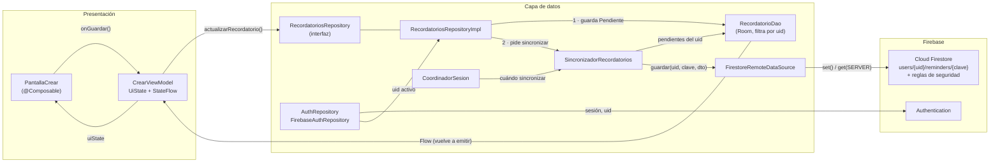
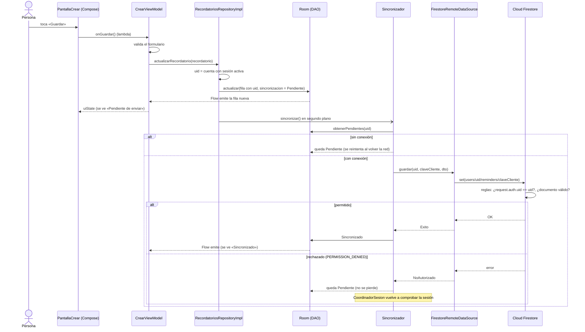

# Arquitectura: de Compose a Firebase

Cómo circula una operación por las capas de la app. Toma como ejemplo **modificar un recordatorio**; crear
y eliminar siguen el mismo camino.

## Capas y responsabilidades

## Recorrido de una modificación

## Qué sabe cada capa

| Capa | Conoce | No conoce |
|---|---|---|
| Composables | `UiState`, lambdas de eventos | ViewModel internos, repositorio, Firebase |
| ViewModel | Interfaces `RecordatoriosRepository` y `AuthRepository`, modelos de dominio | Room, DTO, Firebase, códigos de error |
| Repositorio | DAO, sincronizador, uid activo | Firebase (solo a través de la fuente remota) |
| Fuente remota | Firestore, DTO, mapeo a `Map` | Room, interfaz |
| Clasificadores | Códigos de error del proveedor | Todo lo demás: son funciones puras |

## Modelos en cada capa

| Modelo | Dónde | Para qué |
|---|---|---|
| `Recordatorio` | dominio / interfaz | Lo que ve la persona |
| `RecordatorioEntity` | Room | Fila local: suma `uid`, `claveCliente`, `enRemoto`, estado de sincronización e intentos |
| `RecordatorioDto` | contrato remoto | Solo lo que se comparte entre dispositivos |
| `Map<String, Any>` | Firestore | Documento: el DTO sin la clave (es el id del documento), más `actualizadoEl` del servidor |

Las conversiones están en `data/Mapeos.kt` (dominio ↔ entidad ↔ DTO) y `data/remote/MapeosFirestore.kt`
(DTO ↔ documento).
